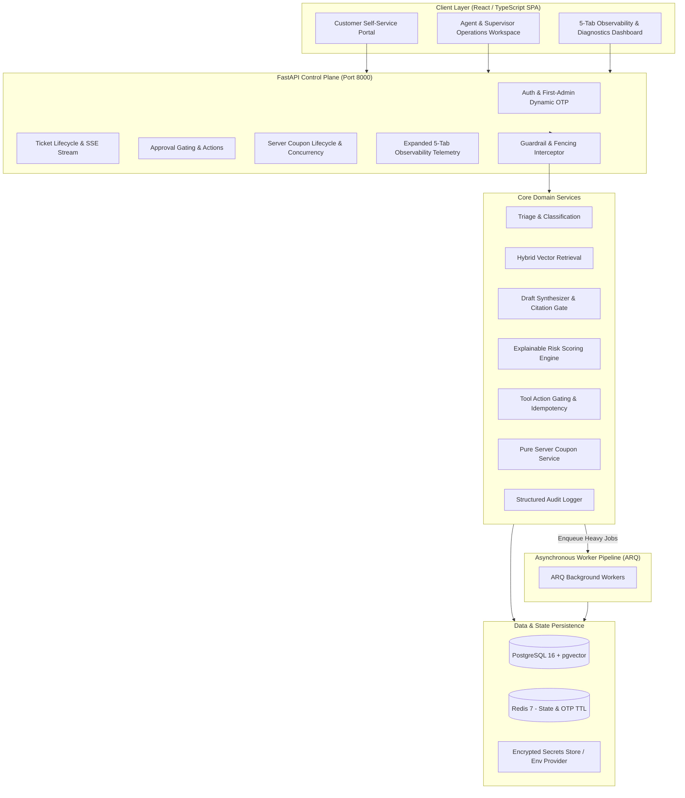

# TrustDesk: Enterprise AI Support Operations Platform

[](https://www.python.org/)
[](https://fastapi.tiangolo.com/)
[](https://react.dev/)
[](https://www.typescriptlang.org/)
[](https://www.docker.com/)
[]()
 
> An AI-first support operations platform engineered for food-tech customer support operations (modelled on Swiggy-scale delivery context). TrustDesk ingests authoritative policies, triages tickets, retrieves policy context via pgvector, drafts grounded customer responses with verified citations, enforces supervisor approval on sensitive operational actions, and neutralizes multi-layered adversarial attacks.

---

## Table of Contents

1. [Executive Summary](#1-executive-summary)
2. [Architecture & System Context](#2-architecture--system-context)
3. [Core Capabilities & Workflows](#3-core-capabilities--workflows)
4. [Technology Stack](#4-technology-stack)
5. [Getting Started & Setup](#5-getting-started--setup)
   - [5.1 Prerequisites](#51-prerequisites)
   - [5.2 Option A: Docker Compose (Recommended)](#52-option-a-docker-compose-recommended)
   - [5.3 Option B: Local Development (Manual)](#53-option-b-local-development-manual)
   - [5.4 Environment Configuration](#54-environment-configuration)
6. [Usage & Operational Workflows](#6-usage--operational-workflows)
   - [6.1 First-Admin Dynamic Registration](#61-first-admin-dynamic-registration)
   - [6.2 Operational Queue Navigation](#62-operational-queue-navigation)
   - [6.3 Grounded Draft Generation & Citation Gate](#63-grounded-draft-generation--citation-gate)
   - [6.4 Sensitive Tool Action Approval Gating](#64-sensitive-tool-action-approval-gating)
   - [6.5 Server-Side Coupon Lifecycle & Concurrency Defense](#65-server-side-coupon-lifecycle--concurrency-defense)
   - [6.6 Non-AI Web Exploit Auto-Closure](#66-non-ai-web-exploit-auto-closure)
7. [5-Tab Observability & Diagnostics Dashboard](#7-5-tab-observability--diagnostics-dashboard)
8. [Evaluation Benchmark Suite (Zero Forged Numbers)](#8-evaluation-benchmark-suite-zero-forged-numbers)
9. [API Reference](#9-api-reference)
10. [Documentation References](#10-documentation-references)

---

## 1. Executive Summary

Traditional customer support bots hallucinate answers, issue unauthorized refunds, ignore company return windows, and fall prey to prompt injection attacks. 

**TrustDesk** enforces a deterministic control plane over generative AI:
- **Grounded over Generative**: The LLM is constrained to company policy documents retrieved via pgvector cosine similarity. If policy evidence is absent or ambiguous, the ticket is automatically escalated to a human supervisor.
- **The Model Proposes, Deterministic Code Decides**: AI models have zero direct agency to execute financial or account-altering actions. Sensitive tools (`start_refund_review`, `create_replacement_order`) are gated behind human supervisor approval with composite idempotency keys.
- **Pure Server-Side Coupon Lifecycle & Concurrency Isolation**: Refund coupons (`SWIGGY-REF-XXXXXXXX`) are generated exclusively server-side, tied to customer accounts, and protected with row-level locking (`SELECT ... FOR UPDATE`) to prevent concurrent double-redemptions.
- **Strict Temporal Fairness**: Return and warranty eligibility windows (e.g. 2-hour food freshness window) are strictly computed against each ticket's `created_at` timestamp—never the calendar date.
- **Comprehensive Adversarial & Exploit Fencing**: Input and output guardrails detect protocol delimiter breakouts, multi-stage roleplay jailbreaks, authority usurpation, and system prompt exfiltration. Non-AI web exploits (SQLi, XSS, Path Traversal) trigger immediate `400 Bad Request` and auto-close the ticket with a critical alert.

---

## 2. Architecture & System Context

TrustDesk follows a modular, asynchronous architecture designed for high volume, zero data loss, and low latency:



---

## 3. Core Capabilities & Workflows

### 3.1 Four-Queue Universal Lifecycle
Tickets navigate through four distinct, strictly gated queue states:
- **Open Queue**: Inbound unassigned customer tickets awaiting triage and agent assignment.
- **Working Queue**: Actively claimed tickets where operatives utilize AI-assisted draft generation and order tracking context.
- **Escalated Queue**: Gated queue containing tickets flagged by AI guardrails, ambiguous policy evidence, or supervisor transfers.
- **Resolved Queue**: Concluded tickets with immutable resolution notes and audit summaries.

### 3.2 Food-Delivery Domain Modeling (Swiggy Ops Context)
Every ticket is linked to enriched food delivery context:
- Customer address, tier (e.g. *Swiggy One*), and order history.
- Restaurant details, kitchen preparation status, delivery partner name, and phone contact.
- Live delivery telemetry: live status messages, delay reasons (e.g., monsoon rains, Indiranagar junction traffic), itemized meal breakdown, and payment method (`INR` / `₹`).

### 3.3 Defense-in-Depth Safety Architecture
- **Input Fences**: Protocol delimiter sanitization, prompt injection neutralizing, and roleplay identity verification.
- **Maker-Checker Guard**: Strict four-eyes principle (`proposed_by_id != approver_id`) with zero self-approval.
- **Cumulative Refund Caps**: Automatic validation that refund amounts never exceed remaining order balances.

---

## 4. Technology Stack

| Layer | Technologies | Purpose |
| :--- | :--- | :--- |
| **Backend** | Python 3.11+, FastAPI, Pydantic v2 | High-performance asynchronous REST API |
| **Database** | PostgreSQL 16 + pgvector extension | Relational storage & vector similarity search |
| **ORM & Migrations** | SQLAlchemy 2.0 (asyncpg), Alembic | Async database operations & migration tracking |
| **Cache & Queues** | Redis 7, ARQ | Job queue, OTP storage with TTL, rate limiting |
| **AI Integration** | OpenRouter API, ProviderAdapter | Multi-model routing with deterministic mock adapter |
| **Frontend** | React 19, TypeScript 5, Vite 8, Tailwind CSS | Responsive, accessible SPA (Swiggy brand palette) |
| **Testing** | pytest, pytest-asyncio, vitest | Comprehensive unit and integration test coverage |

---

## 5. Getting Started & Setup

### 5.1 Prerequisites
- [Docker](https://www.docker.com/) and [Docker Compose](https://docs.docker.com/compose/) v2+
- *(Optional for manual setup)*: Python 3.11+, Node.js 20+, PostgreSQL 16 with `pgvector`, Redis 7

### 5.2 Option A: Docker Compose (Recommended)

1. **Clone the Repository**:
   ```bash
   git clone https://github.com/trustdesk/trustdesk.git
   cd trustdesk
   ```

2. **Launch the Containerized Cluster**:
   ```bash
   docker compose up --build -d
   ```
   This spins up:
   - PostgreSQL 16 with `pgvector` on port `5433` (mapped to `5432` internally)
   - Redis 7 on port `6379`
   - TrustDesk FastAPI API on port `8000`
   - ARQ Background Worker daemon
   - Frontend React SPA on port `5173`

3. **Initialize Database Schema & Knowledge Base**:
   ```bash
   docker compose exec api python init_db.py
   ```

4. **Seed Rich Demo Tickets (15 Scenarios)**:
   ```bash
   docker compose exec api python seed_demo_tickets.py
   ```

5. **Run the Live Evaluation Benchmark**:
   ```bash
   docker compose exec api python test_eval_metrics.py
   ```

6. **Open the Application**:
   Navigate to `http://localhost:5173` in your browser.

---

### 5.3 Option B: Local Development (Manual)

#### 1. Backend Setup
```bash
cd backend
python -m venv venv
# Windows:
.\venv\Scripts\activate
# Linux/macOS:
source venv/bin/activate

pip install -r requirements.txt
cp ../.env.example .env

# Initialize database schema and authoritative KB policies
python init_db.py

# Seed rich operational tickets
python seed_demo_tickets.py

# Launch FastAPI server
uvicorn app.main:app --host 0.0.0.0 --port 8000 --reload
```

#### 2. Frontend Setup
```bash
cd frontend
npm install
npm run dev
```

---

### 5.4 Environment Configuration

TrustDesk provides clean, documentation-rich `.env.example` templates in both the root and `backend/` directories. To customize credentials or connect live LLM providers:

```bash
cp .env.example backend/.env
```

Key environment configurations:
- `DATABASE_URL`: Connection string for PostgreSQL + pgvector
- `REDIS_URL`: Redis connection string for caching and queues
- `JWT_SECRET`: 32+ byte cryptographic key for signing tokens
- `OPENROUTER_API_KEY`: API key for live inference (falls back to deterministic mock provider if unset)
- `SMTP_HOST`, `SMTP_PORT`, `SMTP_USER`, `SMTP_PASSWORD`: SMTP settings for OTP email delivery

---

## 6. Usage & Operational Workflows

### 6.1 First-Admin Dynamic Registration
On initial startup, TrustDesk begins in an unconfigured administrative state:
1. Open `http://localhost:5173`.
2. Click **Register First Admin** on the authentication dialog.
3. The administrative email input starts completely empty (placeholder: `operative@company.com`).
4. Enter your operational email, full name, and master password.
5. The backend dispatches a 6-digit OTP to the entered email address.
6. Enter the OTP code to establish the primary administrator account and unlock full access.

### 6.2 Operational Queue Navigation
- Operatives review tickets categorized by status: **Open**, **Working**, **Escalated**, and **Resolved**.
- Clicking **Assign to Me** claims an open ticket into the active working queue.
- Live order tracking details, delivery partner telemetry, and delay reasons render in the context panel.

### 6.3 Grounded Draft Generation & Citation Gate
- Click **Generate Draft** to synthesize a response using pgvector retrieval.
- Drafts cite authoritative policies (`[KB-SHIPPING-001]`, `[KB-REFUND-001]`).
- If retrieval evidence is insufficient, the system safely falls back to human escalation.

### 6.4 Sensitive Tool Action Approval Gating
- Sensitive actions (`start_refund_review`, `create_replacement_order`) cannot be automatically executed.
- The action status transitions to `pending_approval`.
- A supervisor reviews the action under the **Supervisor Review** tab and approves or rejects the action with full audit logging.

### 6.5 Server-Side Coupon Lifecycle & Concurrency Defense
- Issuing a refund creates a pure server-side coupon (`SWIGGY-REF-XXXXXXXX`) bound to the customer account.
- The UI renders an interactive Swiggy Coupon Card with a 1-click **Copy Coupon** button.
- If two tickets attempt to redeem the same coupon for different orders simultaneously, row-level locking (`SELECT ... FOR UPDATE`) guarantees that exactly one succeeds (`201 Created`), while the duplicate is rejected (`409 Conflict`) and auto-closed.

### 6.6 Non-AI Web Exploit Auto-Closure
- Inbound messages containing SQL injection (`' OR 1=1 --`), XSS (`<script>`), or path traversal attacks are rejected with `400 Bad Request`.
- The system automatically creates a critical auto-closed ticket in the database (`status: resolved`, `close_reason: security_attack_blocked`), alerts administrators, and logs structured audit records.

### 6.7 AI Auto-Resolution & Human Hand-Off Boundary
- **Pure FAQs & Tracking**: Standard informational inquiries (e.g. Swiggy One membership benefits, stationary courier telemetry, monsoon rain delivery delays) are autonomously answered and closed by the AI Agent with authoritative policy citations (`[DOC KB-MEMBERSHIP-001]`, `[DOC KB-SHIPPING-001]`).
- **Human Triage Protection**: Inquiries involving quality defects, spoiled food, curdled dairy, spilled cartons, damaged containers, missing items, or refund demands are strictly barred from auto-resolution, classified at least `Medium Risk`, and preserved in the Open Queue for human operative investigation.

### 6.8 Live Idempotency Verification & Queue Flushing
- **Flushing Demo Queues**: Execute `python backend/seed_demo_tickets.py --clear` to cleanly wipe tickets, messages, drafts, and coupons without dropping table schemas.
- **Interactive Live Idempotency**: Run `python backend/tests/test_live_idempotency.py` to initiate an interactive live test: the script creates a damaged-meal ticket, pauses while an operative approves a refund in the live UI, detects the newly minted coupon, fires concurrent double-redemptions to verify 409 Conflict rejection, and executes an idempotent replay.

---

## 7. 5-Tab Observability & Diagnostics Dashboard

Accessible exclusively to administrators via the **Diagnostics** navigation link or `/#observability`:

1. **Infrastructure & Vitals**: Real-time database ping latency (ms), Redis socket latency (ms), Redis memory consumption (MB), Host RSS memory, CPU percent, system uptime, and exact table row counts across all 9 primary tables.
2. **AI & LLM Telemetry**: Total LLM executions, models deployed, aggregate prompt and completion token counters, calculated inference costs (USD), and percentile latency breakdowns (p50, p90, p95, p99) per model.
3. **Distributed Traces Explorer**: Filterable trace query interface (`run_type`, `risk_level`, `model_used`, `ticket_id`) showing execution duration, token usage, guardrail outputs, and retrieved document counts.
4. **Fraud & Security Intelligence**: Coupon redemption status breakdowns, duplicate replay abuse blocks, 24-hour critical incident counts, prompt injection detections, and recent security events.
5. **System Logs**: Live ring buffer console (1,000 capacity) with level filters (`INFO`, `WARNING`, `ERROR`), regex search, request ID isolation, and auto-refresh controls.

---

## 8. Evaluation Benchmark Suite (Zero Forged Numbers)

TrustDesk includes a standalone evaluation benchmark script that evaluates real triage accuracy, citation coverage, unsafe-action blocking, and escalation behavior against live services and database records:

```bash
# Run locally:
python backend/test_eval_metrics.py

# Or inside container:
docker compose exec api python test_eval_metrics.py
```

### Measured Dimensions:
- **Triage Accuracy**: Measures classification accuracy across all evaluation scenarios.
- **Citation Grounding Coverage**: Validates that grounded queries cite authoritative knowledge base chunks and verifies 0% adversarial citation leakage.
- **Unsafe-Action Blocking Rate**: Verifies 100% interception of prompt injection, over-refund limits (422), closed-ticket action blocks (400), human approval gating, web exploits (SQLi, XSS), and concurrency replay abuse (409).
- **Escalation Behavior Accuracy**: Asserts that all high-risk, security, legal, or ambiguous tickets are routed to senior queues, while routine tickets proceed through standard workflows.

---

## 9. API Reference

Interactive OpenAPI documentation is accessible at `http://localhost:8000/docs`.

### Authentication & Setup (`/api/v1/auth`)
| Method | Endpoint | Description | Auth Required |
| :--- | :--- | :--- | :---: |
| `GET` | `/api/v1/auth/setup-status` | Returns whether primary admin is initialized | Public |
| `POST` | `/api/v1/auth/send-first-admin-otp` | Sends 6-digit OTP to administrative email | Public |
| `POST` | `/api/v1/auth/setup-first-admin` | Verifies OTP and registers primary admin | Public |
| `POST` | `/api/v1/auth/login` | Staff login; returns JWT access token | Public |
| `POST` | `/api/v1/auth/mfa/verify` | Verifies 6-digit email OTP (timing-safe) | Public |
| `POST` | `/api/v1/auth/mfa/resend` | Resends OTP with rate-limit cooldown | Public |

### Administration & Observability (`/api/v1/observability`, `/api/v1/admin`)
| Method | Endpoint | Description | Auth Required |
| :--- | :--- | :--- | :---: |
| `GET` | `/api/v1/observability/stats` | Telemetry, vitals, table counts, AI metrics | Admin |
| `GET` | `/api/v1/observability/traces` | Filterable distributed execution traces | Admin |
| `GET` | `/api/v1/observability/security-summary` | Critical audit log counts and blocked threats | Admin |
| `GET` | `/api/v1/observability/logs` | Queryable live log stream with request ID isolation | Admin |
| `GET` | `/api/v1/admin/users` | Lists staff accounts and roles | Admin |
| `POST` | `/api/v1/admin/users` | Provisions new operative | Admin |

### Ticket Operations (`/api/v1/tickets`)
| Method | Endpoint | Description | Auth Required |
| :--- | :--- | :--- | :---: |
| `GET` | `/api/v1/tickets` | Lists tickets with pagination & category filters | Staff |
| `GET` | `/api/v1/tickets/{id}` | Fetches full ticket details, messages, customer, order | Staff |
| `POST` | `/api/v1/tickets` | Creates ticket (with exploit and injection checks) | Public / Staff |
| `POST` | `/api/v1/tickets/{id}/assign` | Assigns ticket to current operative | Staff |
| `POST` | `/api/v1/tickets/{id}/escalate` | Escalates ticket to Senior Review | Staff |
| `POST` | `/api/v1/tickets/{id}/close` | Concludes ticket; auto-rejects dangling actions | Staff |
| `POST` | `/api/v1/tickets/{id}/refund` | Issues server-side refund coupon | Staff |
| `GET` | `/api/v1/tickets/{id}/draft/stream` | Streams grounded draft tokens word-by-word via SSE | Staff |

---

## 10. Documentation References

For deep technical details, see the guides in `docs/`:
- [`ARCHITECTURE.md`](docs/ARCHITECTURE.md): Topology, loose coupling, hybrid vector search, dual-layer idempotency, and server-side coupon concurrency.
- [`OPERATIONS.md`](docs/OPERATIONS.md): 5-tab observability dashboard runbook, incident triage, log stream isolation, and processing percentiles.
- [`SECURITY.md`](docs/SECURITY.md): Defense-in-depth mitigations, coupon concurrency isolation, non-AI exploit auto-closure, and zero-plaintext secrets management.
