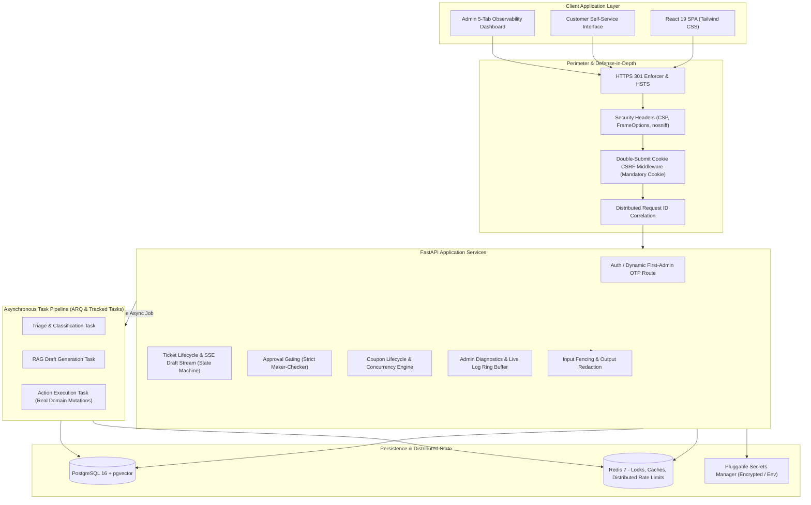
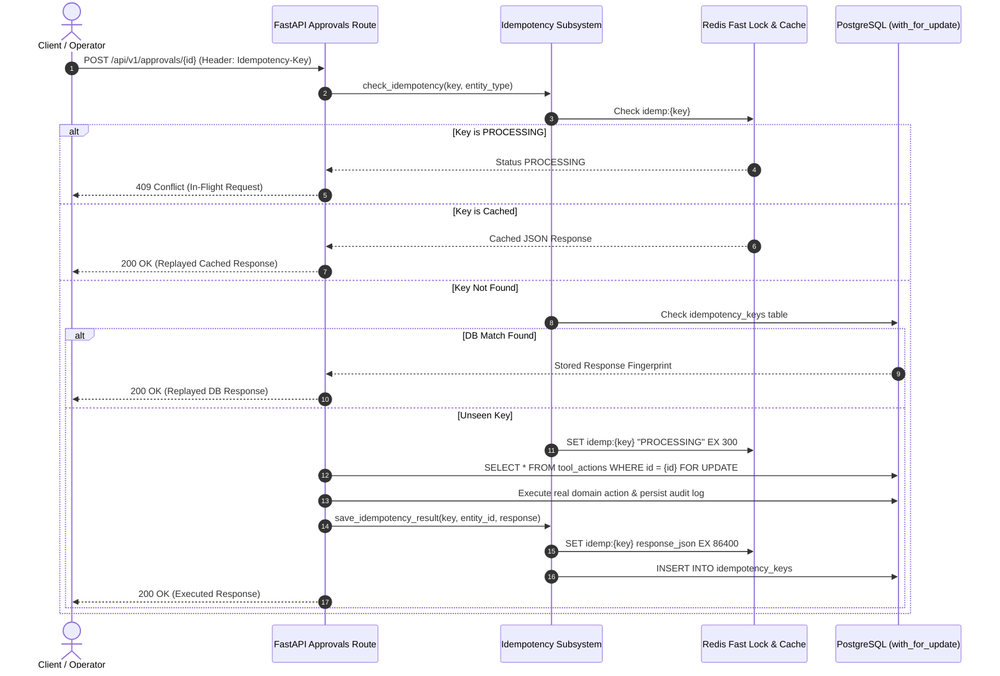
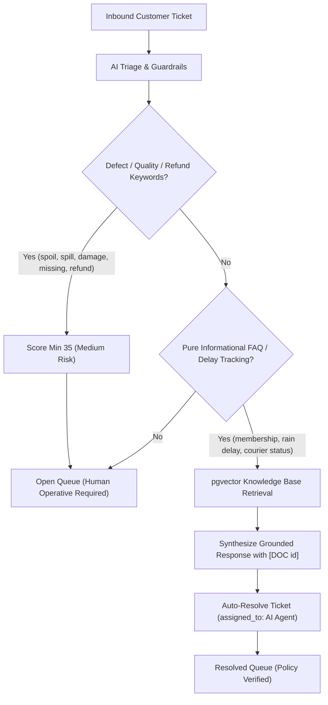

# TrustDesk Architecture Reference

TrustDesk is an enterprise AI-first support operations control plane engineered for high-concurrency commerce and food-delivery workflows (modelled on Swiggy-scale logistics). The platform enforces deterministic business rules, human supervisor approval gating, dual-layer idempotency, and defense-in-depth security over generative AI pipelines.

---

## 1. System Topology



---

## 2. Loose Coupling & Clean Architecture

TrustDesk adheres to strict separation of concerns across presentation, domain, and data layers:

1. **Pluggable Secrets Layer (`app/core/secrets.py`)**:
   - Application configuration and route handlers never directly read raw environment variables or plaintext files.
   - The central `SecretsManager` implements cascading provider resolution (`EnvironmentSecretsProvider` -> `EncryptedSecretsProvider`), masking credentials in memory and logs, and failing fast with `RuntimeError` in production if decryption fails.

2. **Decoupled AI Provider Adapter (`app/ai/provider_adapter.py`)**:
   - The core domain services (`triage_service`, `draft_service`, `retrieval_service`) interact exclusively with an abstract `ProviderAdapter` interface.
   - The provider can be swapped between `OpenRouterProvider` (production LLMs) and `MockProvider` (deterministic unit testing) via configuration without code modifications.

3. **Domain Event & Task Decoupling (`app/workers/tasks.py`)**:
   - Heavy LLM inferencing, embedding recalculations, and evaluations are offloaded to background workers via ARQ and Redis queues.
   - For local development or temporary Redis partition, the system leverages `run_tracked_task()` with GC retention and done-callbacks, preventing unhandled task loss or silent drops.
   - Client requests return `202 Accepted` immediately with a unique `run_id`, preventing HTTP timeout degradation.

4. **Realistic Evaluation Benchmark Suite (`backend/test_eval_metrics.py`)**:
   - Standalone evaluation test script that evaluates live guardrails, triage accuracy, and retrieval coverage against a versioned JSONL evaluation corpus (`data/eval_cases.jsonl`) with real numbers and zero forged data.

---

## 3. Pure Server-Side Coupon Lifecycle & Concurrency Isolation

Refund coupons are generated server-side, stored in PostgreSQL, and protected against concurrency race conditions:

```mermaid
sequenceDiagram
    autonumber
    actor CustomerA as Customer Order 1
    actor CustomerB as Customer Order 2
    participant API as FastAPI Tickets / Coupons Route
    participant Svc as Coupon Service
    participant DB as PostgreSQL (SELECT ... FOR UPDATE)

    CustomerA->>API: Redeem Coupon SWIGGY-REF-XXXXXXXX
    CustomerB->>API: Redeem Coupon SWIGGY-REF-XXXXXXXX (Concurrent)
    API->>Svc: redeem_coupon(code, customer_id, order_id)
    Svc->>DB: SELECT * FROM coupons WHERE code = 'SWIGGY-REF-...' FOR UPDATE
    Note over DB: Row Lock Acquired for Request 1
    DB-->>Svc: Coupon Status: active
    Svc->>DB: UPDATE coupons SET status = 'redeemed', redeemed_order_id = 'order_1'
    Svc-->>API: 201 Created (Verified Discount Applied)
    
    Note over DB: Lock Released; Request 2 Enters
    DB-->>Svc: Coupon Status: redeemed
    Svc-->>API: 409 Conflict (COUPON_ALREADY_REDEEMED)
    API->>DB: Auto-Close Competing Ticket as Duplicate Abuse (risk_level: critical)
    API-->>CustomerB: 409 Conflict (Ticket Auto-Closed)
```

---

## 4. Dual-Layer Idempotency Model

Financial operations, replacement dispatches, and supervisor action approvals require absolute defense against network retries, double-clicks, and distributed race conditions.



---

## 5. 5-Tab Observability Architecture

TrustDesk includes an in-memory circular ring buffer (`MemoryRingBufferHandler`) with a 1,000-event capacity and structured JSON stdout formatter.

- **Distributed Request Tracing**: Python `contextvars` (`request_id_var`, `user_id_var`) propagate request correlation IDs through async functions and background tasks.
- **5-Tab Observability Interface (`/#observability`)**:
  1. *Infrastructure & Vitals*: Real-time database/Redis ping latency, host memory, CPU percent, system uptime, and exact table row inventory.
  2. *AI & LLM Telemetry*: Model deployment distribution, total token metrics (prompt, completion), estimated cost tracking (USD), and percentile latency breakdowns (p50, p90, p95, p99) per model.
  3. *Distributed Traces Explorer*: Multi-factor filtering on distributed traces with guardrail threat inspectability.
  4. *Fraud & Security Intelligence*: Live coupon tracking, duplicate replay block monitoring, and critical incident logs.
  5. *System Logs*: Live ring buffer streaming with search and request ID isolation.
- **Automated PII & Secret Redaction**: Log formatters automatically mask Bearer tokens, passwords, secrets, API keys, and OTP codes.

---

## 6. Operative Assignment Concurrency Architecture

To eliminate race conditions when multiple operatives view and claim tickets from the Open Queue simultaneously:

```mermaid
sequenceDiagram
    autonumber
    actor OpA as Operative A
    actor OpB as Operative B
    participant API as FastAPI Tickets Route (/assign)
    participant DB as PostgreSQL (SELECT ... FOR UPDATE)

    OpA->>API: POST /tickets/{id}/assign
    OpB->>API: POST /tickets/{id}/assign (Simultaneous)
    API->>DB: SELECT * FROM tickets WHERE id = :id FOR UPDATE
    Note over DB: Lock Acquired for Operative A
    DB-->>API: Ticket (assigned_to: NULL, status: open)
    API->>DB: UPDATE tickets SET assigned_to = 'OpA', status = 'working'
    API-->>OpA: 200 OK (Assigned to Operative A)

    Note over DB: Lock Released; Operative B Request Executes
    DB-->>API: Ticket (assigned_to: 'OpA', status: working)
    alt Requesting user is already assignee
        API-->>OpB: 200 OK (Idempotent Replay)
    else Requesting user is different operative
        API-->>OpB: 409 Conflict ("Ticket is already assigned to Operative A")
    end
```

---

## 7. AI Auto-Resolution & Human Hand-Off Boundary

TrustDesk enforces strict domain boundaries between autonomous AI resolution and human operative intervention:


