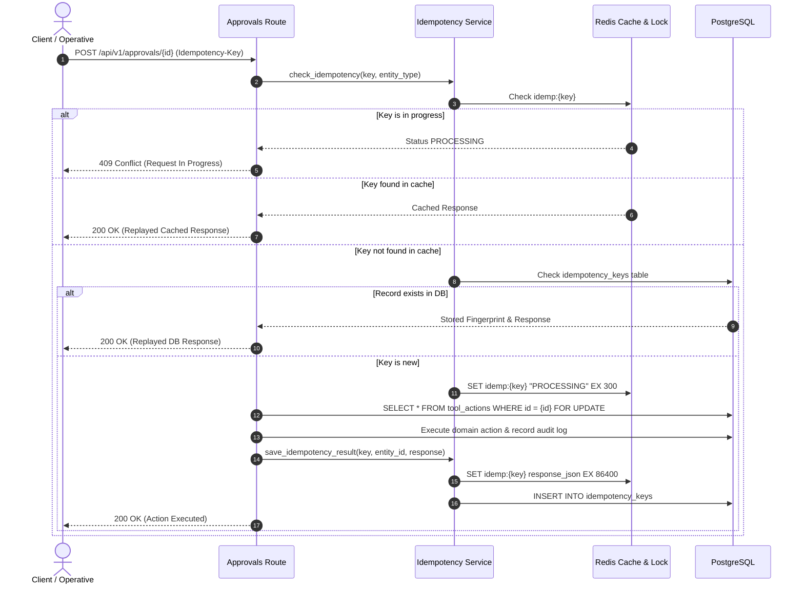
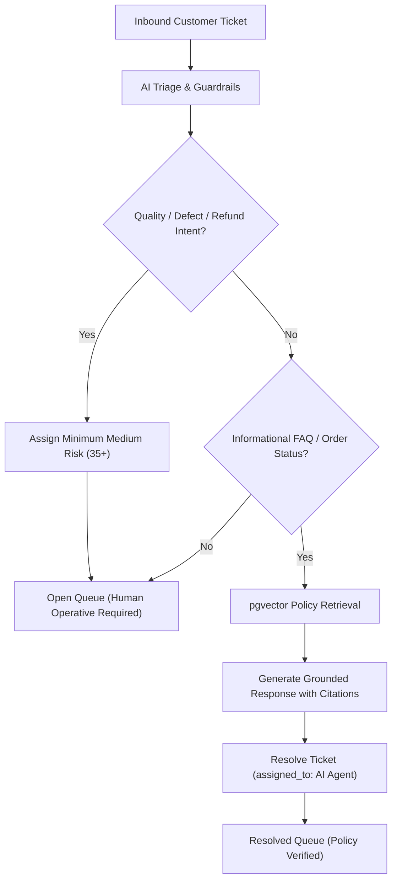

# System Architecture Reference

This document provides a technical specification of the TrustDesk platform architecture, detailing component interactions, concurrency controls, idempotency mechanisms, and data flows.

---

## 1. System Topology

TrustDesk implements a service-oriented architecture separating synchronous API handling from asynchronous background task execution:


---

## 2. Component Design Principles

### Decoupled Secrets Management (`app/core/secrets.py`)
Application components do not access raw environment variables directly. The `SecretsManager` implements a tiered provider hierarchy (`EnvironmentSecretsProvider` -> `EncryptedSecretsProvider`), masking sensitive strings in logs and memory representations.

### Model Abstraction Layer (`app/ai/provider_adapter.py`)
Domain services (`triage_service`, `draft_service`, `retrieval_service`) interact exclusively through an abstract `ProviderAdapter` interface. In production, this routes to `OpenRouterProvider`, while testing environments utilize a deterministic `MockProvider` requiring zero external API dependencies.

### Asynchronous Job Delegation (`app/workers/tasks.py`)
Resource-intensive operations—including vector similarity retrieval, LLM completion, and evaluation suites—are delegated to background workers via ARQ and Redis. In standalone configurations, an internal fallback (`run_tracked_task`) executes tasks concurrently with execution tracking. API endpoints immediately return `202 Accepted` with a tracking `run_id`.

### Continuous Evaluation Benchmark (`backend/test_eval_metrics.py`)
A standalone evaluation suite verifies classification accuracy, citation precision, and guardrail interception against a versioned JSONL evaluation dataset (`data/eval_cases.jsonl`).

---

## 3. Coupon Lifecycle and Concurrency Control

Vouchers and refund credits are minted on the server and guarded against race conditions using PostgreSQL row-level locks:

```mermaid
sequenceDiagram
    autonumber
    actor CustomerA as Customer A (Order 1)
    actor CustomerB as Customer B (Order 2)
    participant API as API Server
    participant Svc as Coupon Service
    participant DB as PostgreSQL (SELECT ... FOR UPDATE)

    CustomerA->>API: Redeem Coupon TRUST-REF-XXXXXXXX
    CustomerB->>API: Redeem Coupon TRUST-REF-XXXXXXXX (Concurrent)
    API->>Svc: redeem_coupon(code, customer_id, order_id)
    Svc->>DB: SELECT * FROM coupons WHERE code = 'TRUST-REF-...' FOR UPDATE
    Note over DB: Lock acquired for Request 1
    DB-->>Svc: Coupon Status: active
    Svc->>DB: UPDATE coupons SET status = 'redeemed', redeemed_order_id = 'order_1'
    Svc-->>API: 201 Created (Coupon Applied)
    
    Note over DB: Lock released; Request 2 executes
    DB-->>Svc: Coupon Status: redeemed
    Svc-->>API: 409 Conflict (COUPON_ALREADY_REDEEMED)
    API->>DB: Auto-close competing ticket as duplicate
    API-->>CustomerB: 409 Conflict (Ticket Auto-Closed)
```

---

## 4. Dual-Layer Idempotency Model

State mutations (such as refunds, replacement orders, and supervisor action approvals) are protected against duplicate requests and network retries using an in-memory lock paired with persistent database records:



---

## 5. Observability and Diagnostics Architecture

The platform includes distributed request correlation and in-memory log retention:

- **Request Context Propagation**: Request identifiers (`request_id_var`) and user contexts (`user_id_var`) are maintained via Python `contextvars` across async boundaries and background workers.
- **Log Buffer**: An in-memory circular ring buffer (`MemoryRingBufferHandler`) retains recent log events with level filtering, substring search, and correlation ID isolation.
- **Telemetry Endpoints**: Exposes real-time system metrics, database row inventories, LLM token expenditures, and percentile response latencies (p50, p90, p95, p99) per model.
- **Data Sanitization**: Sensitive values (Bearer tokens, credentials, cryptographic secrets, OTP codes) are automatically redacted prior to log output.

---

## 6. Ticket Assignment Concurrency Control

To prevent race conditions when multiple operatives claim tickets from the Open Queue simultaneously:

```mermaid
sequenceDiagram
    autonumber
    actor OpA as Operative A
    actor OpB as Operative B
    participant API as Tickets Route (/assign)
    participant DB as PostgreSQL (SELECT ... FOR UPDATE)

    OpA->>API: POST /tickets/{id}/assign
    OpB->>API: POST /tickets/{id}/assign (Concurrent)
    API->>DB: SELECT * FROM tickets WHERE id = :id FOR UPDATE
    Note over DB: Lock acquired for Operative A
    DB-->>API: Ticket (assigned_to: NULL, status: open)
    API->>DB: UPDATE tickets SET assigned_to = 'OpA', status = 'working'
    API-->>OpA: 200 OK (Assigned to Operative A)

    Note over DB: Lock released; Operative B request executes
    DB-->>API: Ticket (assigned_to: 'OpA', status: working)
    alt Requesting user is current assignee
        API-->>OpB: 200 OK (Idempotent Replay)
    else Requesting user is different operative
        API-->>OpB: 409 Conflict ("Ticket already assigned")
    end
```

---

## 7. Automated Resolution and Human Routing Boundary

TrustDesk enforces explicit criteria separating automated AI resolution from human operative routing:


